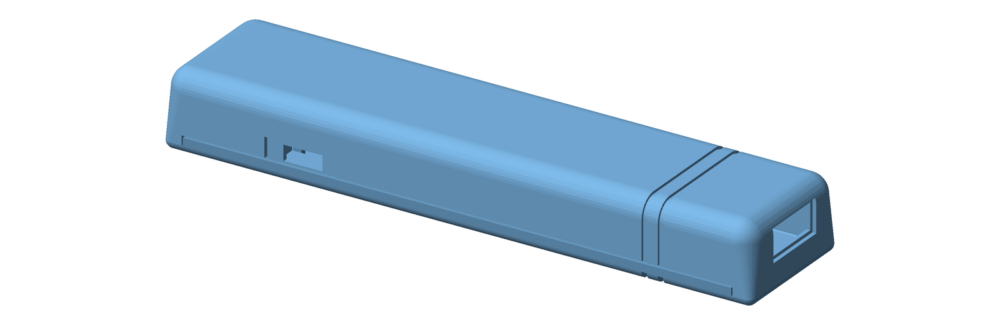
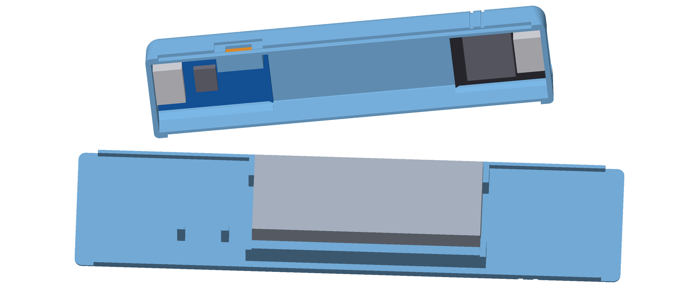
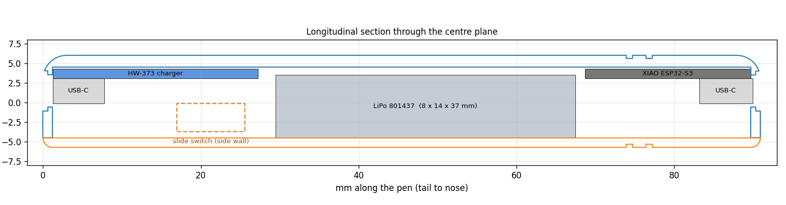

# Pen-Style ESP32-S3 Case

A compact, pen-shaped, 3D-printed enclosure for a **battery-powered XIAO ESP32-S3**. It has its own USB-C charging port at one end, a USB-C programming port at the other, and a slide power switch on the side. Two printed parts, no screws, no supports.



**Size:** 90.9 × 21.2 × 11.7 mm
**Version:** 1.0

---

## What it houses

| Part | Details | Where it sits |
|---|---|---|
| Seeed Studio **XIAO ESP32-S3** | 21 × 17.8 mm, USB-C | Nose end |
| **HW-373 v1.2.1** USB-C charger board (TP4056-type, with battery protection) | about 26 × 17 mm | Tail end |
| **LP801437** LiPo battery | 3.7 V, 350 mAh, 8 × 14 × 37 mm | Middle, on the lid |
| **SS12D00G** micro slide switch | body 8.6 × 3.6 × 3.6 mm | Under the charger, lever through the side wall |

Both USB-C ports are reachable from outside: the **tail port charges the battery** and the **nose port programs / talks to the XIAO**.

---

## What's inside



*Top: the top half seen from below with the HW-373 (tail, left), XIAO (nose, right) and switch (orange). Bottom: the lid with the battery in its holster.*



- **Top half:** the shell, the rails the two boards slide under, both USB-C slots, an enclosed pocket for the switch, and the lever slot with a finger recess.
- **Bottom lid:** a thin floor with a battery holster (two side guides and four corner stops, with an open middle for wires), two small posts that clamp the switch, and a lip that locks into the top half.
- The boards hang from the roof with their components facing down. The battery sits on the lid and rises into the bay between the two boards when the lid is closed.

---

## Files

```
stl/pen_top.stl        top half   (print open side down)
stl/pen_bottom.stl     bottom lid (print flat, lip pointing up)
src/pen_case.py        parametric source that generates both STLs
docs/                  images
requirements.txt       Python dependencies for the source script
```

---

## Printing

| Setting | Suggestion |
|---|---|
| Material | PLA or PETG |
| Layer height | 0.2 mm, 0.4 mm nozzle |
| Walls | 3 perimeters |
| Infill | 15–20% |
| Supports | none |
| Orientation | already set in the STLs |

- **Top half:** prints open side down. The ceiling is an ~18 mm bridge, so turn on bridge cooling.
- **Lid:** prints flat with the lip pointing up.
- If the lid doesn't close fully, check the first layers of the top half for elephant foot along the seam.

---

## Wiring

```
                 +-------------------- HW-373 --------------------+
 USB-C (charge)  |                                                |
 -------------->  |  B+   ----------------------------> LiPo (+)   |
                 |  B-   ----------------------------> LiPo (-)   |
                 |  OUT+ --> [SS12D00G switch] ------> XIAO 5V    |
                 |  OUT- ----------------------------> XIAO GND   |
                 +------------------------------------------------+
```

- **Battery:** B+ and B- on the HW-373 go to the battery's + and -. Solder the battery last and double-check polarity.
- **Switch:** it is a 3-pin SPDT. Connect OUT+ to the **middle** pin and one outer pin to the XIAO's 5V pad. Leave the other outer pin unconnected.
- **XIAO:** connect the 5V and GND pads (castellated edge, near the USB-C port). The battery voltage feeds the on-board regulator through the 5V pad.
- **Do not** connect battery voltage to the 3V3 pin: a full LiPo is 4.2 V.
- To be safe, switch the pen off before plugging a USB cable into the XIAO, or add a Schottky diode in series with the 5V feed.
- The rails cover about 0.6 mm of each long edge of both boards. Solder wires before sliding the boards in, keep joints low-profile, and use thin wire (about 30 AWG).
- Run the wires along the free lanes on either side of the battery.

---

## Assembly

1. **Wire it up** as above. Pre-solder the switch and the XIAO and HW-373 wires before the boards go in.
2. **Turn the top half upside down.** Lay the HW-373 and the XIAO in the middle bay with their flat backs facing the roof and their USB-C ends toward the ends of the pen.
3. **Slide each board outward** under its rails until its USB-C seats in the end slot.
4. **Seat the switch** in its pocket from inside the cavity, with the lever toward the side wall, and thread the lever through the slot.
5. **Place the battery** in the holster on the lid. A strip of double-sided tape helps hold it.
6. **Close the lid.** The lip locks into the top half and the two posts hold the switch in place. A drop of glue or a wrap of tape keeps the halves together.

---

## Customizing

Everything is generated from `src/pen_case.py`. Edit the parameters at the top of the file, then regenerate:

```bash
pip install -r requirements.txt
python src/pen_case.py
```

The STLs are written to `stl/`. Useful parameters:

| Parameter | Meaning | Default |
|---|---|---|
| `XIAO['T']`, `XIAO['G']` | XIAO PCB thickness and rail gap | 1.2 / 1.65 mm |
| `TP['L']`, `TP['W']`, `TP['T']`, `TP['G']` | HW-373 size, thickness and rail gap | 26 × 17 × 1.2, gap 1.65 mm |
| `BAT['L']`, `BAT['W']` | Battery holster size | 38 × 14.6 mm |
| `SW_L`, `SW_W`, `SW_H` | Switch body size | 8.6 × 3.6 × 3.6 mm |
| `IWH`, `IHH` | Inner half-width / half-height of the cavity | 9.1 / 4.5 mm |
| `WALL`, `END`, `FLOOR` | Wall, end-wall and lid-floor thickness | 1.5 / 1.2 / 1.2 mm |

The script also runs clearance checks (boards, battery and switch against both printed parts) and prints the results.

---

## Notes and assumptions

These dimensions are estimated, so please verify before printing:

- **HW-373 size** (about 26 × 17 × 1.2 mm) comes from typical TP4056 USB-C boards.
- **XIAO PCB thickness** is assumed to be 1.2 mm. The rails leave 0.45 mm of vertical play, so thinner boards also fit.
- **Switch lever height** isn't in the part number. About 3 mm is assumed.
- **Battery:** the cavity allows about 8.3 mm of thickness, so a swollen cell won't fit.
- The boards float slightly sideways in the cavity, and the USB-C slots are 9.6 mm wide. A board that sits off-center may need a nudge to line up with its slot.

**LiPo safety:** use a protected cell, don't crush or puncture the battery, and don't charge it unattended.
